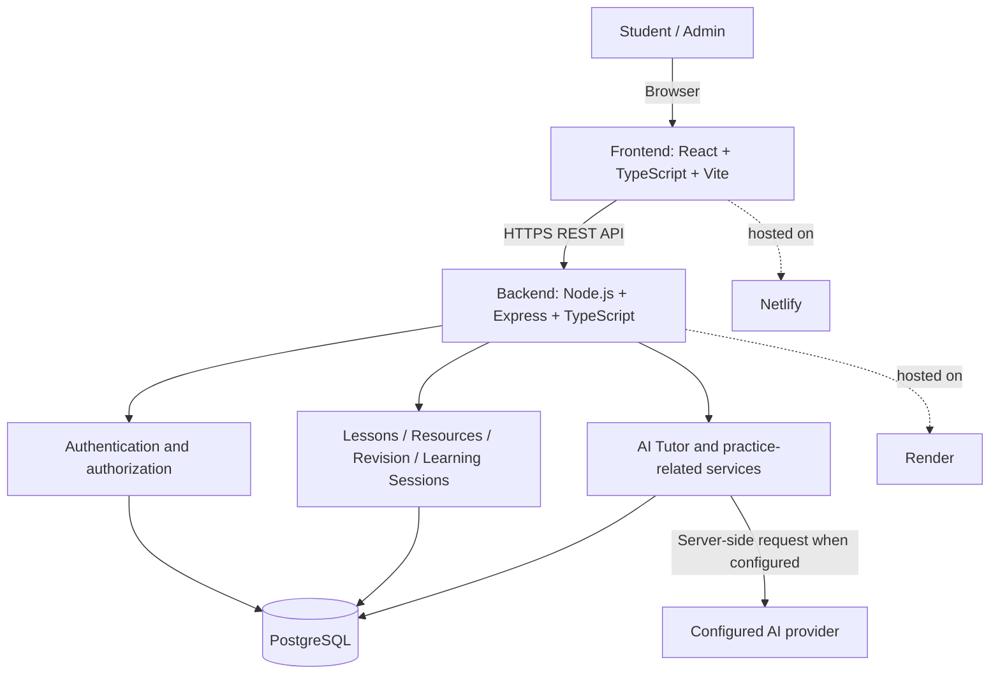

# Learnova Tutor — System Architecture

## Responsibilities
- **Frontend:** displays screens and sends API requests.
- **Backend:** validates requests, applies business rules, handles auth, reads/writes database records, and calls the configured AI provider where implemented.
- **PostgreSQL:** persistent application data, structured by SQL migrations.
- **AI provider:** configured server-side; keep credentials out of frontend code.
- **Hosting:** intended frontend on Netlify and backend on Render.

## Example login flow
1. User submits login details in the frontend.
2. Frontend calls the backend login endpoint.
3. Backend validates the request and checks the PostgreSQL user record.
4. Backend returns the configured authentication response.
5. Frontend updates the session/UI.

This is a logical architecture diagram. Confirm exact auth and feature implementation against source code.
